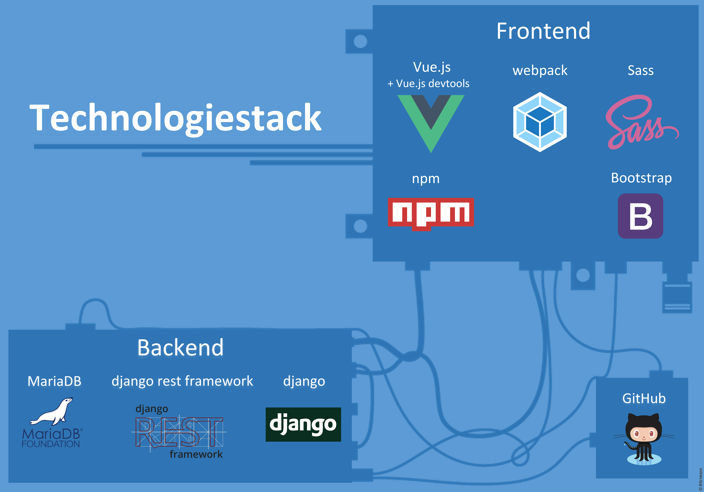

  

<h1 align="center">Young & Digital Learning — Interactive Demo</h1>

  <!-- Workflow GitHub Actions - Deployment -->
  
  <!-- Workflow GitHub Actions - Deployment status -->
  
   
  <!-- Website Online/Offline -->
  
  <!-- Website Uptime 7 days -->
  
  <!-- GitHub - Last commit -->
  
   
  <!-- Vue.js -->
  
  <!-- Cody Style Prettier -->
  
   
  <!-- GitHub License -->
  

  <a 
    target="_blank"
    rel="noopener noreferrer" 
    href="https://younganddigitallearning.github.io/"
  >
    <strong>Launch Interactive Demo</strong>
  </a>

## Frontend

### ydl-front submodule frontend

Website for Y&D Learning made in Vue.

This project was completed for the module "Programming Lab: Social Networking" at TU Berlin.

## Setup tutorial

[Setup](https://github.com/YoungAndDigitalLearning/ydl-front/blob/master/Setup.md)

## Links

Our organization: [YoungAndDigitalLearning](https://github.com/YoungAndDigitalLearning)

Homepage: [YoungAndDigitalLearning.github.io/ydl-front](https://YoungAndDigitalLearning.github.io/ydl-front/)

Wikipage: [wiki](https://github.com/YoungAndDigitalLearning/ydl/wiki)

## Tech Stack YDL

View bigger image file: [Image Link](https://raw.githubusercontent.com/YoungAndDigitalLearning/ydl-front/master/images/stack_features.jpg)

## Modules

- [Main](https://github.com/YoungAndDigitalLearning/ydl)
  - [Frontend](https://github.com/YoungAndDigitalLearning/ydl-front)
  - [Backend](https://github.com/YoungAndDigitalLearning/ydl-api)

---

Other names:
YD Learning, Y&D Learning, Young & Digital Learning
